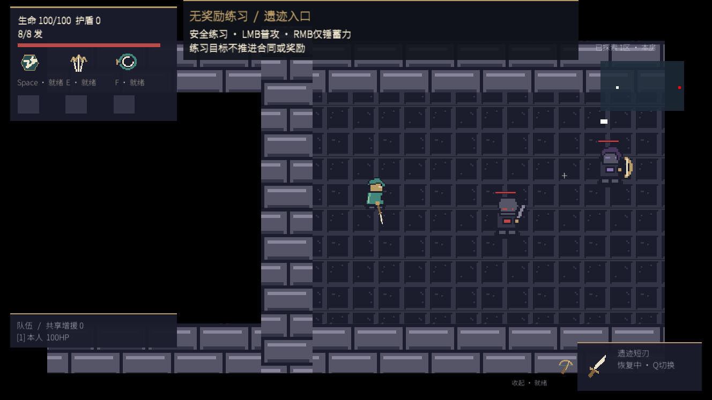
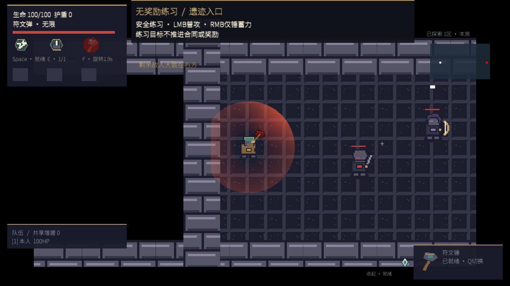

# Dungeon Contract

**Go游戏服务端 × Unity权威战斗的合作地下城Demo。** 围绕“组队入局—战斗事实—合同进度—奖励结算—返回大厅”构建完整业务链路，重点展示重连、乱序、重复请求与部分失败下的一致性处理。

Go负责身份、组队匹配、版本准入和持久化；Unity权威服务负责高频移动、碰撞与战斗；玩家端负责输入、预测和表现。当前面向Windows本机及受限LAN／Radmin试玩，Go内部采用模块化单业务进程。

[2分29秒Web演示与截图](docs/portfolio/demo-walkthrough.md) · [架构与三条时序](docs/portfolio/architecture-overview.md) · [后端快速启动](docs/portfolio/backend-quickstart.md) · [完整游戏构建](docs/portfolio/full-demo.md) · [当前验证范围](docs/portfolio/current-status.md) · [公开交付](docs/portfolio/publication.md)

| 游侠 | 工匠 |
| --- | --- |
|  |  |

两张游戏画面来自2026-11-09当前源码／二进制绑定的UI探针场景，展示战斗与HUD，不是联机通关录像。Web操作画面及现场演示安排见[演示说明](docs/portfolio/demo-walkthrough.md)。

## 服务端设计看点

- **版本与身份绑定的入局**：冻结内容、世界和配置指纹，校验Run、分配、权威来源与玩家连接代次，隔离旧会话与不兼容客户端。
- **可靠事实与幂等回执**：相同ID和内容返回既有结果，冲突拒绝；乱序帧有界暂存，按连续水位应用，避免重复推进合同。
- **事务结算与奖励防重**：参与者结果、唯一奖励来源、资产余额与账本共同提交，失败后补齐剩余成员。
- **可恢复的通知与缓存**：Outbox随业务事务落库，客户端查询补齐遗漏通知；Redis投影从MySQL重建。
- **可审查的交付**：版本Schema、源码／配置指纹、完整构建回执、隔离存储测试和公开源码允许清单各自记录来源。

实现见[可靠事实与结算](docs/portfolio/reliability-and-settlement.md)，讲解入口见[面试提纲](docs/portfolio/interview-notes.md)。

## 技术栈与职责

| 层次 | 技术 | 职责 |
| --- | --- | --- |
| 业务服务 | Go、Gin、Gorilla WebSocket、JWT、bcrypt | 身份、组队、匹配、准入、控制、合同、结算与Worker |
| 持久化与投影 | MySQL、Redis | 持久事实／奖励／账本及可重建投影 |
| 战斗与客户端 | Unity 6000.3.25f1、C# | 独立权威战斗、玩家预测、状态恢复与表现 |
| 辅助Web界面 | React、TypeScript、Vite | 管理与控制流程 |
| 工程与验证 | Docker Compose、PowerShell、Python、GitHub Actions | 隔离服务、构建／包审计、自动验证 |

当前运行身份为设计2.5、`dc_ruins.v8.p5.1`、战斗协议8、控制协议`/ws` V2，合同语义`dc_tasks.v5.p4.1`。

## 快速启动Go后端

需要PowerShell 7、Docker Desktop和[go.mod](backend/go.mod)声明的Go工具链；这一入口不要求Unity。从源码根目录执行：

```powershell
pwsh -NoProfile -File ./deploy/portfolio.ps1 -Action Prepare
pwsh -NoProfile -File ./deploy/portfolio.ps1 -Action ServicesStart
pwsh -NoProfile -File ./deploy/portfolio.ps1 -Action Initialize
pwsh -NoProfile -File ./deploy/portfolio.ps1 -Action CheckServices
pwsh -NoProfile -File ./deploy/portfolio.ps1 -Action GoTest
pwsh -NoProfile -File ./deploy/portfolio.ps1 -Action GoVet
```

`GoTest`／`GoVet`不要求数据库。首次运行、启动后端和已有数据处理见[快速开始](docs/portfolio/backend-quickstart.md)；可用 `-ProjectRoot`、`-CacheRoot`、`-PrivateRoot`指定目录，默认缓存在源码外。`Initialize`按校验和检查原顺序迁移，不是重置操作；不要复制其他机器的private目录、账号或数据库。

隔离当前v8真实存储与竞态检查：

```powershell
pwsh -NoProfile -File ./deploy/portfolio-ci-dc.ps1 -Race
```

这个入口创建自己的临时存储并在结束后清理。不能手工把集成测试指向已有玩家库；资源不足会在启动前拒绝，保留内存保护线。

## 构建与试玩

完整游戏源码构建需要Windows、Unity 6000.3.25f1的Windows构建支持及可用许可证，以及Go、Python、PowerShell和Docker；步骤见[完整构建](docs/portfolio/full-demo.md)。源码不携带编译好的玩家端或开发机凭据。

- 本机入口：`start-v8.cmd`
- LAN主机：`start-v8-lan-host.cmd`
- 玩家：从构建出的同批完整玩家包运行`start-v8-player.cmd`
- [玩家操作](docs/game-demo/v8-player-guide.md) · [零基础LAN／Radmin教程](docs/game-demo/radmin-human-multiplayer-guide.md)

LAN路径只用于明确允许的私有／Radmin地址，不自动安装VPN、修改防火墙或开放公网，MySQL／Redis不向玩家开放。

## 验证与边界

[11月9日复核](docs/portfolio/review-20261109.md)完成73组原生、23组兼容、普通构建、双角色UI和LAN包离线审计；[11月10日续作](docs/portfolio/review-20261110.md)完成当前v8隔离存储加race：6个顶层测试及9个Worker子例，零失败／跳过。后端单元／vet／模块校验、两套前端构建与80项源工具测试通过。各自范围及后继浏览器／发布状态见[当前状态](docs/portfolio/current-status.md)。

[Web验证](docs/portfolio/browser-validation.md)已在独立临时环境中补齐真实登录、权限、观察页、房间操作和重连检查，另以Chromium执行7项Control夹具断言。Git发布行尾的回归覆盖索引、ZIP和双克隆；后继工具计数与远程CI以实际提交运行结果为准。

用户报告最新已有玩家包完成联机、整局和返厅续局，未发现重大问题；没有补填人数、设备、网络和包哈希。最多4人是设计能力，不据此声称四人跨机稳定验证。已取消的性能和完整流程复验保持取消，不写为PASS。当前不承诺商业并发、公网安全、自动扩容、跨进程战斗恢复或最终平衡；[威胁模型](docs/portfolio/game-realtime-gm-demo-threat-model.md)说明具体边界。

## 代码导航

- [Go业务模块](backend/internal/pve) · [权威事实入口](backend/internal/pve/gameplay/frame.go) · [奖励结算](backend/internal/pve/settlement/service.go)
- [协议与持久化设计](docs/portfolio/protocol-and-data.md) · [当前v8状态契约](docs/game-demo/contracts/runtime-v8/README.md)
- [测试与证据](docs/portfolio/testing-and-evidence.md) · [公开文档索引](docs/public-index.md) · [公开导出策略](docs/portfolio/public-export-manifest.json)

## 来源、发布与许可

本仓库由既有工程导出独立源码快照，保留真实来源，不伪造逐日Git历史。发布目录按允许清单生成，不提交凭据、数据库、Unity缓存、VHDX、私密测试记录或玩家二进制。

前身[game-realtime-gm](https://github.com/lki-H/game-realtime-gm)保留V2／GM业务基础、实际旧版回退及独立RPC／消息报表实验；本仓库从其401247d基线派生并承担可玩战斗后继开发。两库的运行环境、数据与验证各自独立，共享缺陷按[维护对应表](docs/portfolio/repository-lineage.md)逐项核对，不重复计算项目成果。

本地大厅有一张可选AI装饰背景，分发权尚未确立；公开源码排除该图及提供方记录，使用客户端已有替代背景。代码采用[MIT](LICENSE)，不改变Unity、字体、音频、素材或依赖的各自条款；分发前阅读[许可说明](LICENSE-NOTICE.md)和[第三方声明](THIRD_PARTY_NOTICES.md)。
