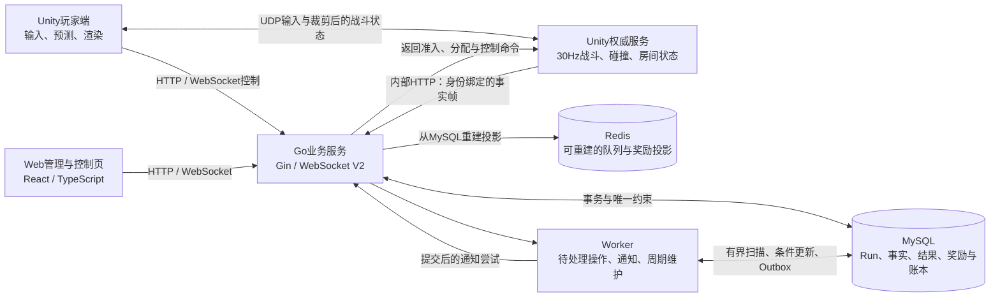
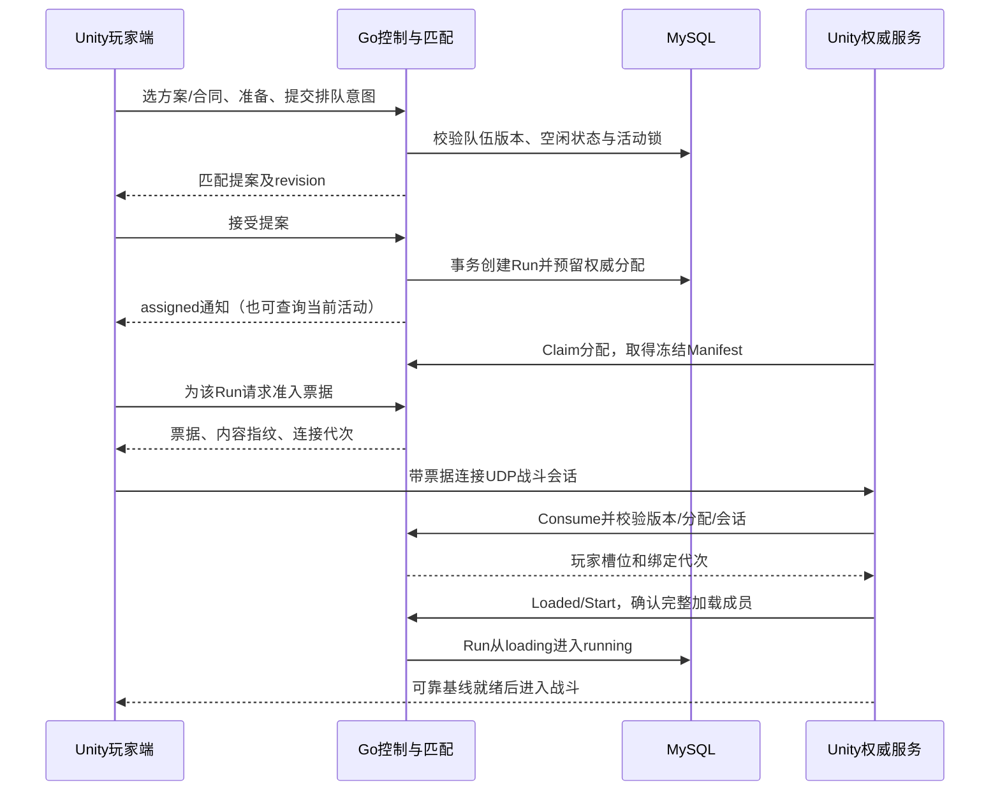
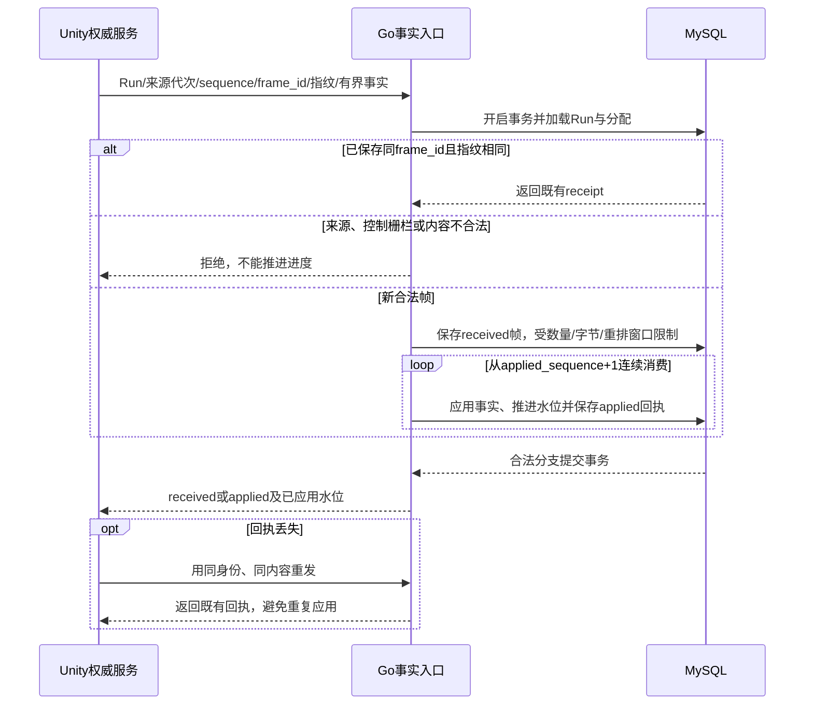
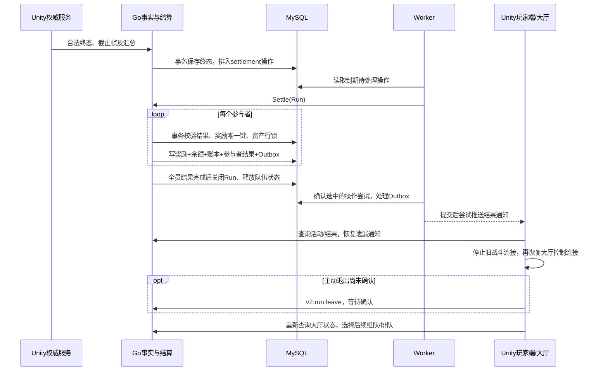

# 架构与三条关键链路

Dungeon Contract把高频战斗与持久化业务分开：Unity权威服务运行战斗模拟，Go服务处理身份、组队、匹配、准入、可靠事实、合同和结算。Go内部按模块组织，以单业务进程部署；Unity权威是独立进程。

LAN模式额外使用受限玩家网关，向明确允许的IP开放玩家入口；Go内部接口与存储继续限制在本机。Go业务模块共享数据库和事务边界，没有声明为独立部署的微服务。

| 模块 | 负责什么 | 源码入口 |
| --- | --- | --- |
| 身份与传输 | JWT期限、会话、HTTP／WebSocket权限与消息限制 | [auth](../../backend/internal/auth/jwt.go)、[WebSocket传输](../../backend/internal/handler/v2_transport.go) |
| 组队与匹配 | 队伍版本、准备状态、匹配提案、玩家活动占用与Run创建 | [party](../../backend/internal/pve/party/service.go)、[matchmaking](../../backend/internal/pve/matchmaking/service.go) |
| 权威准入 | 内容指纹、分配、票据、来源代次、连接代次与加载确认 | [gameplay/service.go](../../backend/internal/pve/gameplay/service.go) |
| 战斗模拟 | 移动、碰撞、攻击、弹体、机关、陷阱与状态同步 | [Unity入口](../../client/unity-demo/Assets/DungeonContract/Runtime/DcP0V3.cs)、[v8世界](../../client/unity-demo/Assets/DungeonContract/Runtime/DcV8World.cs) |
| 事实与经济 | 事实序列、任务进度、终态结果、奖励唯一性与账本 | [frame](../../backend/internal/pve/gameplay/frame.go)、[settlement](../../backend/internal/pve/settlement/service.go) |
| 恢复与维护 | 幂等操作、有限重试、Outbox通知、Redis投影重建 | [store](../../backend/internal/pve/store/store.go)、[worker](../../backend/internal/pve/worker/worker.go)、[projection](../../backend/internal/pve/projection/service.go) |

## 1. 组队、匹配与版本化入局

匹配提案确认与权威Claim／玩家票据申请存在异步交接，图表示依赖关系，不要求网络响应严格按显示顺序到达。准入校验操作、内容、世界、试炼和配置指纹，不能靠客户端补默认字段加入不兼容的局。实现见[匹配提案确认](../../backend/internal/pve/matchmaking/service.go)、[分配／Issue／Consume／Start](../../backend/internal/pve/gameplay/service.go)与[Unity控制入口](../../client/unity-demo/Assets/DungeonContract/Runtime/DcP0V3.cs)。

## 2. 权威事实、乱序与重试

接收成功与已经应用是不同状态；缺前帧时不能跨序号推进任务。相同身份但内容不同返回冲突，超过有界窗口的输入也拒绝。高频位移、弹体位置和碰撞仍留在Unity，不逐帧写入MySQL。代码与Schema见[事实入口](../../backend/internal/pve/gameplay/frame.go)、[当前帧契约](../game-demo/contracts/frame-v8-p5.schema.json)与[运行状态契约](../game-demo/contracts/runtime-v8/README.md)。

## 3. 终态、结算与返回大厅

Outbox在业务事务内落库，推送发生在发布状态提交后；进程在两者之间失败时，客户端依靠查询恢复，不能描述成“客户端恰好接收一次”。结算见[SettleParticipant／FinalizeRun](../../backend/internal/pve/settlement/service.go)，重试见[Worker](../../backend/internal/pve/worker/worker.go)，返厅顺序见[DcP5Lobby.ReturnFromRun](../../client/unity-demo/Assets/DungeonContract/Runtime/DcP5Lobby.cs)。

## 部署与故障边界

当前Go进程持有数据库所有权锁，同库再启动一个进程不构成水平扩容。Unity是高频战斗信任根，Go验证业务所需的有限事实，不重新模拟每次碰撞。业务确认不可用可触发受控技术等待，两个进程不是完全独立的故障域。跨进程战斗崩溃恢复、多实例容错、公网部署及商业SLO需要另行设计和验证。

验证记录见[当前状态](current-status.md)、[11月10日隔离存储与竞态检查](review-20261110.md)及[威胁模型](game-realtime-gm-demo-threat-model.md)。
