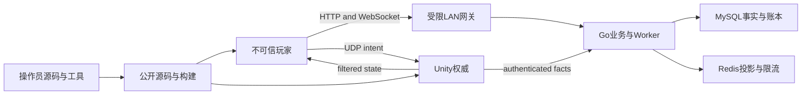

# Dungeon Contract：当前公开Demo威胁模型

复核日期：2026-11-07；2026-11-09补充构建来源，2026-11-10补充隔离存储与诊断验证。范围：当前Go业务面、Unity权威与客户端同步、LAN网关、源码导出及构建交付。本文更新当前公开说明，不覆盖旧版威胁模型或把历史结果迁给新源码。

## 使用场景与假设

- 沿用用户已确认的Windows本机／受限LAN／Radmin展示场景，公开源码，不等于公开互联网部署。
- 玩家可以修改客户端、重放和乱序请求、断线重连、发送畸形数据。玩家没有主机文件写权限、MySQL／Redis凭据或权威服务密钥。
- 操作员控制源码、冻结内容和服务端；Unity权威是战斗事实的信任根。权威主机被控制后伪造战斗不属于客户端防作弊保证。
- 当前Go进程通过数据库命名锁限制同库业务单实例；不宣称多实例容错、自动扩容或跨进程战斗恢复。
- 用户报告的联机成功属于真人反馈，不证明所有攻击路径、网络保密或性能已通过。

如果以后开放公网、允许不可信主机或拆出独立多实例服务，需要重新评估入口、防护和故障域；这不是本轮额外部署要求。

## 系统与信任边界

| 边界／资产 | 现有控制与代码依据 | 残余边界 |
| --- | --- | --- |
| 玩家→LAN网关 | 精确IPv4允许列表、玩家路由白名单、剥离转发与内部身份头、请求体和连接数限制：[gateway.go](../../backend/internal/dclan/gateway.go) | 应用层不承诺TLS；私有IP与VPN名称不是链路保密证明 |
| 玩家→Go身份／业务 | JWT签名与期限、bcrypt、玩家会话／状态校验、HTTP／WS限额：[auth](../../backend/internal/auth/jwt.go)、[传输](../../backend/internal/handler/v2_transport.go)、[请求限制](../../backend/internal/middleware/resource_limits.go) | 合法用户仍可在限额内发恶意业务请求；权限检查必须逐请求执行 |
| 玩家→Unity权威 | 票据审批、Run／来源／连接代次、输入序列与动作修订、服务裁决；[准入](../../client/unity-demo/Assets/DungeonContract/Runtime/DcP0V3.cs)、[动作](../../client/unity-demo/Assets/DungeonContract/Runtime/DcS2Runtime.cs) | 客户端能预测表现，不能提交命中或伤害结论；不抵抗已控制的权威 |
| 权威→客户端 | 兴趣裁剪、基线／修订、可靠生灭、墓碑与有界待处理状态；[同步](../../client/unity-demo/Assets/DungeonContract/Runtime/DcV6Sync.cs)、[角色增量](../../client/unity-demo/Assets/DungeonContract/Runtime/DcV5Runtime.cs) | 恢复中的旧消息不能刷新冷却或重复播放历史攻击，渲染不推进真实伤害 |
| 权威→Go事实 | 本机内部端口、服务身份、Schema、帧水位、内容指纹及事务；[内部入口](../../backend/internal/pve/gameplay/http.go)、[可靠帧](../../backend/internal/pve/gameplay/frame.go) | 业务不可用会触发受控技术等待，不属于与战斗完全隔离的故障域 |
| Go→持久化 | 参数化SQL、事务、奖励唯一键与账本；[结算](../../backend/internal/pve/settlement/service.go)、[重试](../../backend/internal/pve/worker/worker.go) | Redis可重建；Outbox提交后推送是可查询恢复的通知，不保证客户端恰好收到一次 |
| 操作员→公开源码／包 | 路径和链接边界、私密文件权限、允许清单、精确导出审计和构建文件清单；[路径](../../deploy/dc_paths.py)、[导出](../../deploy/portfolio-export.py)、[公开审计](../../deploy/portfolio-public-audit.py)、[构建](../../deploy/dc_v8_build_identity.py) | 哈希绑定说明对应关系，不是数字签名；不能证明未知来源二进制可信 |

## 主要攻击路径及本轮处理

| ID | 攻击路径／故障 | 资产与影响 | 本轮控制或处理 | 剩余优先级 |
| --- | --- | --- | --- | --- |
| TM-01 | 重放旧JWT、会话或签名正确但缺少期限的令牌 | 身份与管理员权限 | 期限必须存在且有效；原有签名、会话与玩家状态检查保留。缺少期限必须先有合法签名，不能称为签名绕过 | 低；密钥泄露另需轮换 |
| TM-02 | 重放旧连接动作／事实或并发重试 | 生命、合同、奖励完整性 | 代次、动作／事件指纹、帧收据和奖励事务继续作为裁决边界；Worker只能分派已知操作，旧执行结果不能覆盖新计划／完成状态 | 中；真实数据库并发验证需与测试身份对应 |
| TM-03 | 乱序基线与增量、恢复时重复效果 | 操作状态和可用性 | 角色增量按代次／修订有界暂存，基线落地后有序合并；超限请求恢复；不补播已落地的历史锤击 | 中；原生检查与实机结果分别记录 |
| TM-04 | 慢连接、超量输入、恶意重同步 | 内存、网络与服务可用性 | 既有HTTP／WS和权威限额保留；新增待处理状态有消息数与字节上限，不以无限缓存容错 | 中；不承诺公网抗DoS |
| TM-05 | 导出配置或缓存时夹带凭据／链接逃逸 | 账号、服务密钥、开发机文件 | 私密目录位于源码外，检查链接祖先与私密文件权限；仅审定允许清单复制，精确审计导出文件、内容和本地引用 | 中；仍须审核实际拟提交和Release附件 |
| TM-06 | 同名旧包／不完整回执掩盖引擎或服务文件替换 | 发布完整性 | 绑定完整角色交付文件，而非只检查少数DLL；新源码／资源变化后重建并取得新回执；不改写旧回执 | 中；公开Release尚未发布 |
| TM-07 | LAN明文或错误放行内部端口 | 凭据保密与服务权限 | 仅绑定受限地址，内部端口和存储留loopback，教程仅为精确程序／IP放行玩家TCP／UDP | 条件风险；敌对LAN或公网需另行设计传输保护 |

## 验证与限制

各项修复和实测状态见[原复核](review-20261107.md)及[11月9日续作](review-20261109.md)。后者补齐完整源码输入（包括共享脚本、导入器、meta及嵌入资源）和实际LAN构建归属校验；新增全局Worker测试在建立夹具前要求隔离runner标记，禁止误用已有玩家库。单元测试、协议模型、导出审计和真实存储／Unity实机结果分别记录；跳过和环境阻塞不转为通过。本模型没有新增公网部署、商业SLO或已取消的整局／性能重测要求。

本轮未更换密钥、重置数据库、修改既有迁移或改动源图片／音频／字体。不存在“通过威胁模型便证明绝对安全”的结论。后续每次公开提交仍需审查实际文件及其依赖与授权。

[11月10日续作](review-20261110.md)已完成当前v8真实MySQL与竞态检查，范围为6个顶层测试及Worker的9子例，不扩大为并发负载或全后端证明。失败诊断只采集本轮临时容器的有界状态／日志，先遮蔽生成的凭据再序列化；不读取完整环境或借诊断访问原玩家容器。
